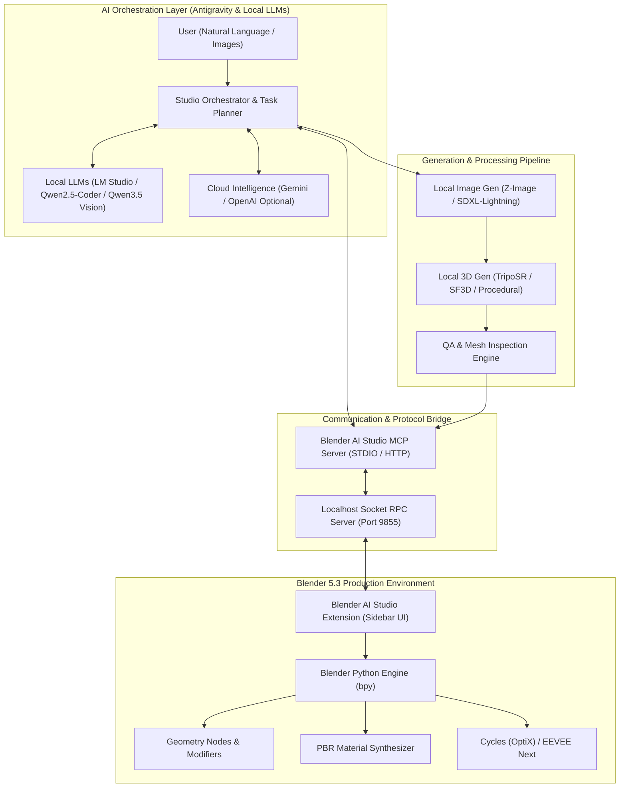

# System Architecture & Technical Design

## 1. High-Level Architectural Diagram

---

## 2. Component Breakdown

### A. Core Orchestrator (`Core/`)
- **`config.py`**: Central system configuration, managing storage thresholds (>= 25GB), port definitions, paths, and timeouts.
- **`orchestrator.py`**: Central coordinator receiving user requests, selecting optimal modeling techniques (procedural vs generative), routing tasks, and maintaining execution state.
- **`vram_monitor.py`**: Real-time VRAM and system memory supervisor ensuring memory budgets remain under 8GB to prevent OOM errors.

### B. Communication Bridge (`Core/bridge/`)
- **Blender Localhost Socket Bridge**: A lightweight, non-blocking TCP socket server running inside Blender on `localhost:9855`. Handles JSON-RPC payloads to execute commands inside Blender's main thread using `bpy.app.timers`.
- **MCP Server (`Core/mcp_server.py`)**: Exposes the 14 standard Blender operations defined in the Master Directive to Antigravity as first-class tools.
- **Headless Fallback Driver**: When Blender GUI is closed, the bridge can execute scripts headlessly via `blender-launcher.exe -b`.

### C. Local AI Integration (`AI/Local/`)
- **`lm_studio_client.py`**: Connects to LM Studio's local server (`http://127.0.0.1:1234/v1`) or standalone llama runtime with automatic model health checks, context management, and token stream handling.
- **`bpy_generator.py`**: Specialized prompt templates tailored for `Qwen2.5-Coder-7B` to generate clean, verified, syntax-checked Blender Python scripts.
- **`vision_inspector.py`**: Feeds viewport snapshots and render outputs to `Qwen3.5-9B` + `mmproj` for geometric and visual quality assessment.

### D. Production Automation & Blender Extension (`Blender/`)
- **`Blender/Extensions/blender_ai_studio/`**: A native Blender 5.3 add-on presenting a professional 7-tab N-panel interface:
  1. `Create` — Prompt-to-3D, Image-to-3D, Multi-view to 3D, Text to Image.
  2. `AI Assistant` — Chat, modify selected object, explain object, fix errors.
  3. `Generation Engine` — Engine status, local vs cloud routing, VRAM gauges.
  4. `Materials` — Procedural PBR nodes, texture assignment, normal map strength.
  5. `Production` — Retopology, cleanup, lighting presets, camera framing, Cycles rendering.
  6. `Quality Control` — Non-manifold checks, normal orientation, UV islands, export readiness.
  7. `Settings` — Localhost ports, model directories, API keys (local-first).

### E. Quality Assurance Engine (`Core/qa/`)
- Checks mesh geometry for zero-area faces, non-manifold edges, inverted normals, unapplied transforms, loose vertices, and degenerate UV maps. Produces markdown and JSON audit reports before export.

