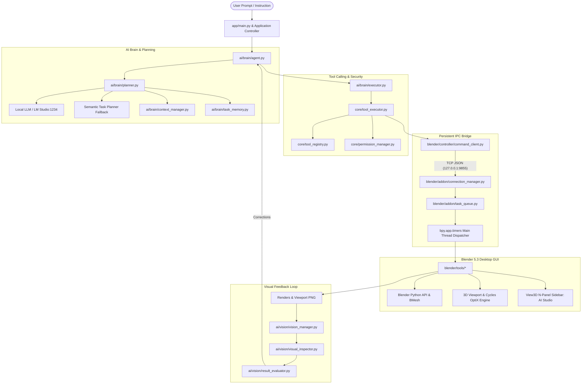

# Blender AI Studio: System Architecture Document

## 1. Executive Summary & Philosophy
**Blender AI Studio** is an autonomous AI agent engineered to interact directly with the live, running desktop Blender GUI. Unlike traditional procedural scripts or monolithic prompt-to-code generators, Blender AI Studio behaves like an autonomous 3D artist seated in front of Blender:
1. It **observes** the live 3D scene hierarchy and properties.
2. It **plans** multi-step operations using structured, validated tool calls.
3. It **executes** actions on Blender's main thread via a persistent, non-blocking IPC socket bridge.
4. It **evaluates** geometry, materials, and visual renders.
5. It **iterates** on follow-up user feedback, modifying existing objects without redundant recreation.

---

## 2. System Architecture Diagram

---

## 3. Core Subsystems

### 3.1 Main-Thread Safety & The Persistent Socket Bridge
Blender's Python API (`bpy`) is strictly single-threaded and unsafe to call from background worker threads. Attempting direct API manipulation from a standard socket thread causes segmentation faults or state corruption.
- **Connection Manager**: Listens on `127.0.0.1:9855`. Incoming JSON payloads are authenticated against `AUTH_TOKEN`.
- **Task Queue**: Incoming requests are packaged into thread-safe `QueuedCommand` objects with individual `threading.Event` synchronization primitives.
- **Main Thread Executor**: Uses `bpy.app.timers.register(main_thread_timer_tick, persistent=True)` running every 20ms on Blender's UI thread. It pops commands, executes the mapped tool in `TOOL_MAP`, records results, and triggers the completion event.

### 3.2 Tool Registry & Schema
All actions are encapsulated into strictly validated, discrete tools:
- **Scene Tools**: `inspect_scene`, `inspect_object`
- **Object Tools**: `create_object`, `delete_object`, `select_object`, `transform_object`, `duplicate_object`
- **Mesh Tools**: `create_mesh`, `create_truncated_icosahedron`, `edit_mesh`, `extrude`, `inset`, `bevel`, `subdivide`
- **Modifier Tools**: `add_modifier`, `configure_modifier`, `apply_modifier`
- **Material Tools**: `create_material`, `assign_material`, `edit_nodes`
- **Camera & Lighting**: `setup_camera`, `setup_light`
- **Rendering & IO**: `render_preview`, `capture_viewport`, `save_project`, `export_asset`

### 3.3 Task Planning & Multi-Turn Memory
- **Task Memory**: Retains catalog of created objects, categories, and references so instructions like *"make the seams deeper and darken the leather"* resolve to the active `Realistic_Football` without duplicating geometry.
- **Hybrid Planner**: Queries local models via `LMStudioClient` with function calling schemas; seamlessly falls back to the deterministic semantic planner when running completely offline.

### 3.4 Visual Intelligence & Result Evaluation
- Evaluates real image metrics (mean perceived luminance, contrast standard deviation, resolution).
- Detects underexposure (< 0.12 luminance) and flat contrast (< 0.08), recommending lighting and rim adjustments before finalizing exports.
